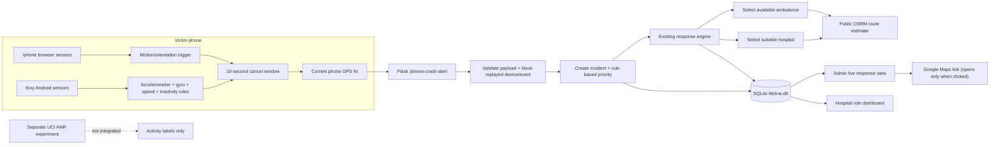

# SAYA — Help That Stays With You

SAYA is an academic emergency-response prototype showing how smartphone
motion sensing, GPS, incident intake, resource selection, route estimates, and
an admin dashboard can fit together. **It is not a certified crash detector or
an emergency service. No ambulance or hospital is contacted by this project.**

## What is here

- A phone-monitoring page at `/phone` and a Kivy/Android client under `mobile/`.
- A cancellable phone-alert flow that sends a device/event ID and coordinates
  to Flask at `/phone-crash-alert`.
- A SQLite incident/assignment store in `lifeline.db`, using the configured
  database path when `SAYA_DATABASE_PATH` is set.
- Rule-based priority calculation, ambulance/hospital selection, OSRM route
  estimates, and a role-protected live response dashboard.
- Controlled phone and CCTV simulation routes, visibly separated from live
  phone sensor input.
- A stand-alone, reproducible UCI activity-recognition experiment under
  [`research/`](research/README.md). Its models are not used by Flask.

## Architecture



See [architecture and workflow diagrams](docs/architecture.md) for the complete
sequence and scope notes.

## Data science experiment

No crash-labeled dataset was present in the project. The separate UCI Human
Activity Recognition Using Smartphones (HAR) dataset has six daily-activity
labels and **no crash or accident labels**. The experiment checks the actual
archive and official participant split, then evaluates a majority baseline,
Logistic Regression, and Random Forest on activity recognition only.

On its official subject-disjoint test set (2,947 windows), measured macro F1
was 0.0514 for the most-frequent-class baseline, 0.9555 for Logistic
Regression, and 0.9271 for Random Forest. **These are not crash-detection
metrics and do not justify model integration into dispatch.** Dataset audit,
limitations, false-positive/negative counts, plots, and rerun steps are in
[`research/README.md`](research/README.md).

## Setup and run (Windows)

Use the existing project environment; do not rebuild the Android/Buildozer
toolchain for the Flask demonstration.

1. Open a fresh PowerShell window in the project root. Keep the existing
   `lifeline.db` untouched. Use a new temporary database for the public demo
   so pre-existing incident locations are not shown:

   ```powershell
   $demoDb = Join-Path $env:TEMP ("saya-demo-" + [guid]::NewGuid().ToString() + ".db")
   $env:SAYA_DATABASE_PATH = $demoDb
   .\.venv\Scripts\python.exe database.py
   .\.venv\Scripts\python.exe seed_data.py
   ```

   `seed_data.py` appends fictional sample ambulance/hospital rows; run it
   only once for this new database.

2. Set private bootstrap credentials for the new demo database:

   ```powershell
   $adminSecret = Read-Host "Choose a new admin bootstrap password" -AsSecureString
   $env:SAYA_ADMIN_PASSWORD = [System.Net.NetworkCredential]::new("", $adminSecret).Password
   $hospitalSecret = Read-Host "Choose a new hospital bootstrap password" -AsSecureString
   $env:SAYA_HOSPITAL_BOOTSTRAP_PASSWORD = [System.Net.NetworkCredential]::new("", $hospitalSecret).Password
   ```

3. Configure a private session-signing key for this server process:

   ```powershell
   $secretBytes = New-Object byte[] 32
   $rng = [System.Security.Cryptography.RandomNumberGenerator]::Create()
   $rng.GetBytes($secretBytes)
   $env:SAYA_SECRET_KEY = [Convert]::ToBase64String($secretBytes)
   $rng.Dispose()
   ```

   Never commit these values. Set `SAYA_COOKIE_SECURE=1` only when serving
   over HTTPS.

4. Start Flask:

   ```powershell
   .\.venv\Scripts\python.exe app.py
   ```

5. On the computer, visit `http://127.0.0.1:5000/phone` and
   `http://127.0.0.1:5000/admin/login`. Use the admin password chosen above.
   For a phone browser, connect both devices to the same trusted LAN and open
   `http://<PC-LAN-IP>:5000/phone`; allow motion and location permissions.
   Restrict Windows Firewall access to the trusted LAN. Do not expose this
   prototype to the public Internet.

`mobile/config.py` has the Android client's API URL. A packaged Android build
can only reach this machine if that URL matches the PC's LAN address. Existing
Buildozer artifacts were left untouched.

The demo database remains at the unique path printed by `$demoDb`. Stop Flask
with Ctrl+C. Keep or remove only that exact database when you are finished;
the original `lifeline.db` is not modified by this setup or the supplied test
runner. Avoid using a copy of the existing incident database for a public
presentation unless its stored locations have been reviewed and sanitized.

## Tests and research commands

Run the backend regression suite against a disposable copy of the existing
database (the runner removes only its own temporary copy):

```powershell
.\.venv\Scripts\python.exe backend\run_safe_tests.py
.\.venv\Scripts\python.exe -m unittest research.test_experiment
```

Run the separate research experiment (first install its isolated optional
dependencies; this does not change production or Android requirements):

```powershell
.\.venv\Scripts\python.exe -m pip install -r research\requirements.txt
.\.venv\Scripts\python.exe research\run_har_experiment.py
```

The research script downloads the source archive into the ignored
`research\data\` cache, validates its SHA-256, and writes metrics and a plot to
`research\results\`.

### Verified results

- Backend regression suite: **59 passed, 0 failed**. The runner used a
  disposable copy of `lifeline.db`; route-provider results were mocked for
  deterministic tests. Live-response tests cover stored resource details,
  waiting reasons, ambulance/hospital route-failure fallback without invented
  ETAs, explicit idempotent dispatch retry, concurrent resource claims, route
  coordinate conversion, and separation across incidents.
- Research data-validation tests: **3 passed, 0 failed**.
- The UCI HAR experiment completed and reproduced the metrics documented
  above.
- Fresh-database setup smoke test: schema creation and one-time sample seeding
  produced five ambulances and five hospitals; `/phone`, authenticated
  `/admin/live`, and `/admin/live/data` returned HTTP 200 after successful
  admin login. The unauthenticated live page redirected to login and the live
  data API returned HTTP 401.
- Loopback browser smoke test: Leaflet rendered stored test-fixture locations
  and routes; simulated movement followed the stored road geometry, displayed
  simulated progress, then reset cleanly. Missing-route and unassigned
  incidents did not enable movement, and no browser JavaScript errors occurred.
- Pylance syntax checks found no syntax errors in the changed Python files.

## API and demonstration

- [Existing endpoint contracts, fields, statuses, and authentication](docs/api.md)
- [Architecture and end-to-end workflow diagrams](docs/architecture.md)
- [3–5 minute competition demo script](docs/demo.md)
- [Dataset audit and measured activity experiment](research/README.md)

## Implemented, tested, simulated, and planned

| State | Scope |
|---|---|
| Implemented | Browser/Android phone monitoring code; rule-based crash assessment; cancellation countdown; phone alert intake; incident persistence; admin/hospital role pages; priority/resource selectors; transactional resource reservation; stored OSRM route geometry; retry endpoint; Leaflet live-response maps; timestamps in Asia/Kolkata; explicit route-unavailable states. |
| Tested | Flask test-client phone/live pages, duplicate event handling, multiple independent incidents, validation, authentication gates, resource shortages, route failure without fabricated ETAs, idempotent retry, concurrent ambulance claims, map coordinate conversion, and research-data validation. The regression tests use a disposable database and deterministic mocked routes. |
| Simulated | Named phone sensor scenarios and CCTV events; sample ambulance/hospital inventory; explicitly labelled demo movement along a stored OSRM route. Demo positions never update ambulance GPS records and are not real vehicle tracking. |
| Planned / not established | Crash-labeled training data, measured crash-classification performance, authenticated device-to-server alert credentials, ambulance GPS ingestion/devices, production routing, live emergency-provider integrations, real fleet/hospital availability, deployment hardening, and operational validation. |

## Safety, privacy, and limitations

- The phone detector is a prototype rule system. Its score is not a calibrated
  probability. Browser sensor triggering and Android sensor fusion are not
  equivalent pipelines.
- The live phone alert endpoint remains unauthenticated so a phone can submit
  an event in this prototype. Admin and resource APIs require an admin session,
  but production device authentication, rate limiting, and abuse controls are
  not implemented.
- Public OSRM receives route coordinates; Google Maps receives coordinates
  when a user opens a map link. Use only controlled/demo coordinates unless
  those disclosures are acceptable. Public routing can be unavailable or
  unsuitable for emergency use.
- GPS accuracy, speed, assignment availability, and ETAs are shown only when
  data is available. Sample inventory is not a real dispatch network. This
  project has no ambulance GPS feed; the dashboard's optional marker animation
  is explicitly simulated and follows stored route geometry.
- The response page shows current status and report time, not a durable
  status/assignment audit timeline.
- SQLite data contains incident locations. Protect the database, restrict the
  host firewall, and do not include real patient/location data in screenshots,
  competition materials, or public repositories.
- This project has no verified deployment or emergency-service connection.

## Honest resume / interview framing

- Built a Python/Flask and SQLite prototype that accepts smartphone crash
  alerts with GPS, validates bounded coordinates and event identifiers, and
  preserves incidents when resources are unavailable.
- Implemented a rule-based multi-signal phone detector and tested a
  cancellation, alert, duplicate-protection, and assignment workflow with
  controlled test data.
- Evaluated Logistic Regression and Random Forest on the UCI smartphone
  **activity-recognition** dataset using its subject-disjoint split; reported
  macro metrics and per-class false positives/negatives.
- Integrated geospatial resource selection and route-estimate presentation in
  an academic prototype; route-provider calls are external and not a real
  emergency dispatch.
