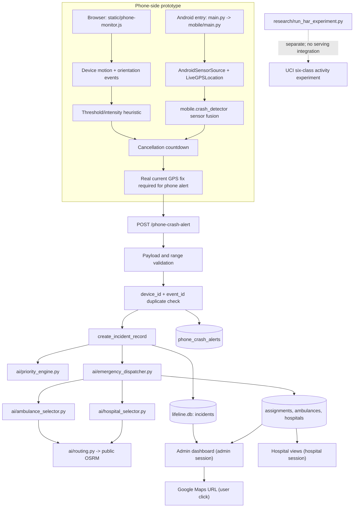

# SAYA architecture and workflow

## Component architecture



**No external ambulance or hospital is contacted.** The assignment engine
updates this local prototype database and calls a public route-estimation API.
The administrator dashboard refreshes its rendered incident list every ten
seconds. Hospital pages show the assignments associated with the logged-in
hospital.

## Phone-to-dashboard sequence

```mermaid
sequenceDiagram
  participant P as Phone browser or Android client
  participant F as Flask
  participant D as SQLite
  participant E as Response engine
  participant R as OSRM route API
  participant A as Admin dashboard

  P->>P: Monitor sensors using prototype rules
  P->>P: Show cancellation countdown
  alt User cancels
    P-->>P: Return to monitoring; send no incident
  else Countdown expires
    P->>P: Require a recent real GPS fix
    P->>F: POST /phone-crash-alert (device/event, coordinates, score)
    F->>F: Validate payload and coordinate ranges
    F->>D: Check prior device_id + event_id
    alt Duplicate event
      F-->>P: 409 DUPLICATE_BLOCKED and prior incident ID
    else New event
      F->>D: Create incident and rule-based priority
      F->>E: Attempt ambulance/hospital selection
      E->>R: Request two route estimates
      alt Resources and routes available
        E->>D: Save assignment and mark incident Assigned
        F-->>P: 201 AUTO_DISPATCHED (local simulation only)
      else Resource or route unavailable
        E->>D: Keep incident Waiting without an assignment
        F-->>P: 202 WAITING_FOR_RESOURCES
      end
    end
    A->>D: Read all incidents, including unassigned ones
    A-->>A: Render latest state; refresh every 10 seconds
  end
```

The route estimate can fail. The incident remains visible with `Waiting`
status when assignment cannot be completed. The test suite mocks OSRM to make
dispatch tests deterministic; it does not prove live provider availability.

## Data separation

`research/` contains a separately run activity-classification experiment. Its
target labels are walking/upstairs/downstairs, sitting, standing, and laying.
It has no crash label, is not imported by the Flask application, and does not
alter detector thresholds or dispatch behavior.
